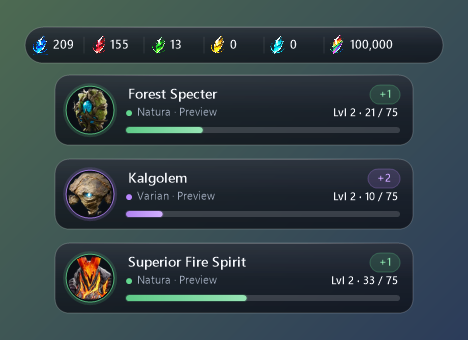
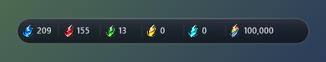
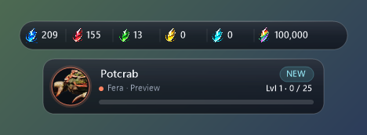
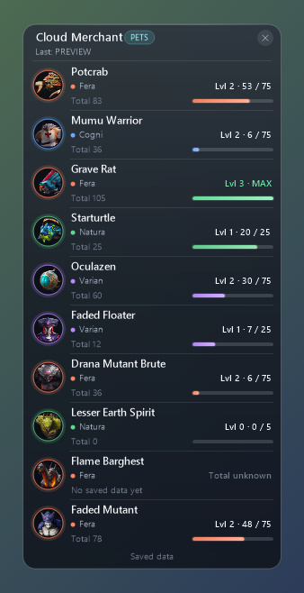
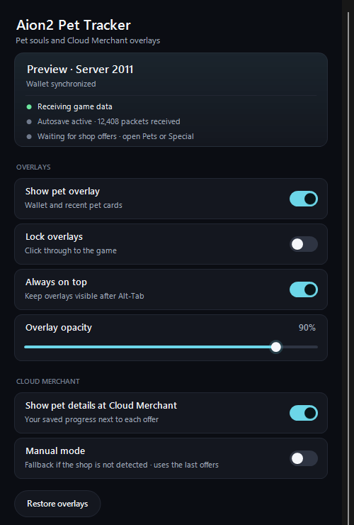
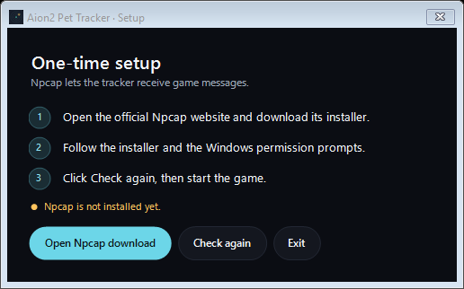

# Aion2 Pet Tracker · Glass Edition

Track your **pet souls, crystal balances and pet progress** with compact overlays for AION 2.

> **This is a modified fork** of [MyGitStash/Aion2PetTracker](https://github.com/MyGitStash/Aion2PetTracker) with a redesigned, minimal glass interface.
> Tracking, capture and saving work exactly as in the original. See [what changed](docs/FORK-NOTICE.md).

## ⬇️ Download for Windows

### [Download Aion2 Pet Tracker · Glass Edition](https://github.com/TasosK7/Aion2PetTracker/releases)

Pick the newest release and download **Aion2-Pet-Tracker.zip** from its *Assets*.
**One ZIP. Extract it, run the tracker, then start the game.** No separate .NET installation is needed.

> The EXE is not code-signed. If Windows SmartScreen warns you, choose **More info → Run anyway**.

## 🚀 Quick Start

1. [**Download the tracker ZIP**](https://github.com/TasosK7/Aion2PetTracker/releases) and **extract it** to a folder.
2. Run **Aion2PetTracker.exe**.
3. If prompted, install [Npcap](https://npcap.com/#download) once, then click **Check again**.
4. **Start AION 2 and log in.** Your character is detected automatically.
5. Position the overlays, then enable **Lock overlays**.

> **For future sessions: start the tracker first, then the game.**

## ✨ Features

- **Pet soul tracking** — See each pet’s portrait, group, level and soul progress.
- **Multi-pet farming** — Track several pets in separate cards.
- **Crystal balances** — Keep your group crystals and Rainbow souls in view.
- **Cloud Merchant information** — Check your saved pet progress while browsing pet offers.
- **Always on top** — Keep overlays visible after Alt-Tab, including on a second monitor.
- **Glass design** — Translucent cards, group-coloured accents and slim progress bars that stay out of the way.

## 📸 Screenshots

*All screenshots are rendered from demo data without personal information.*

<strong>Crystal balances</strong>

The permanent wallet bar keeps all six crystal balances together, including Rainbow souls.

<strong>New pet notification</strong>

A compact chip highlights a newly registered pet.

<strong>Cloud Merchant pet information</strong>

A separate panel shows pet groups, levels and soul totals for the available pet offers.

<strong>Settings and setup</strong>

Live status at the top, switches for every option and a one-time Npcap setup screen.

## 💾 Saving & Updates

- Your progress **saves automatically**.
- Keep the **Daten** folder when updating to preserve your settings and saved progress.
- Closing settings minimizes the tracker to the taskbar. Click its taskbar icon to reopen it.
- **Always on top** is enabled by default. Turn it off if you prefer other apps to cover the overlays.
- Use **Restore overlays** in settings or the tray menu if you need to bring the overlays forward.
- To close it completely, right-click the tray icon and select **Exit**.

<strong>Cloud Merchant panel missing?</strong>

Open **Pets** or **Special** in the shop and check the shop status in the tracker settings.
If needed, enable **Manual mode** under *Cloud Merchant*. This uses the last received valid offers.
With **Always on top** enabled, the panel keeps the last observed shop offers visible when you switch apps.
It updates the shop view when you return to the game; it does not read another app’s screen.
If it still does not appear, select **Copy shop diagnostics** from the tracker’s tray menu and include them in a bug report.

## Source code

The complete source is available in [`src/`](src/), with regression tests in
[`tests/`](tests/) and the original notices in [`licenses/`](licenses/).
Changes made in this fork are listed in [`docs/FORK-NOTICE.md`](docs/FORK-NOTICE.md).
See the [build and review guide](docs/SOURCE-README.md#build-from-source) to build
the Windows application yourself. The public repository excludes personal saved
character data and private captures.

**Just want to play? Use the download link above.** GitHub’s automatic “Source code” downloads are for building the application yourself.

## License

GPL-3.0, like the original project. See [`LICENSE`](LICENSE) and [`docs/FORK-NOTICE.md`](docs/FORK-NOTICE.md).
AION 2 names, portraits and game artwork belong to NCSOFT and their respective rights holders.
This is an independent fan project, not affiliated with or endorsed by NCSOFT.
